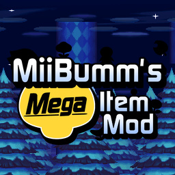
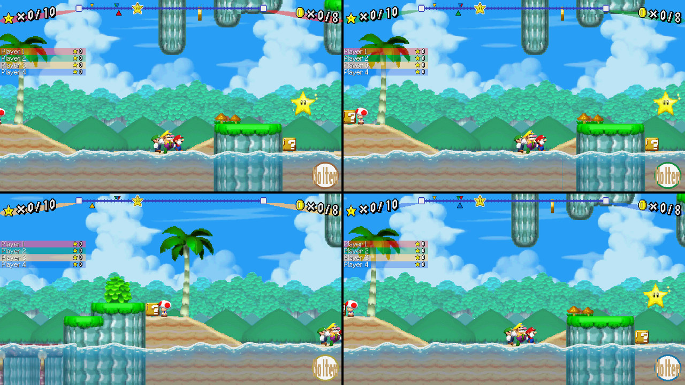
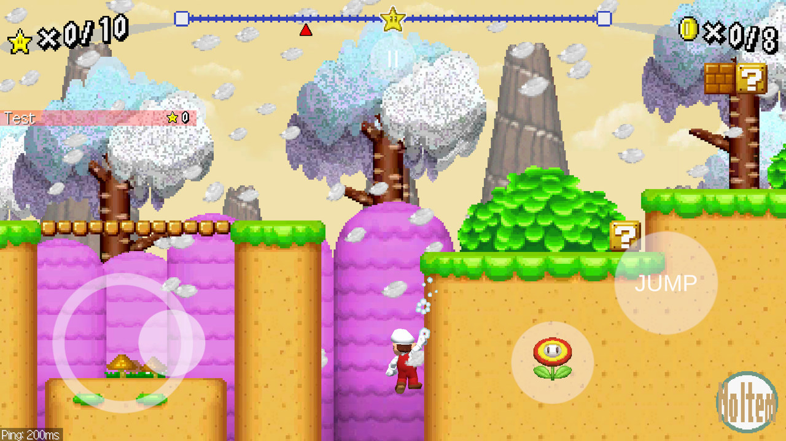

<div align="center">



# mmim_nx

**MiiBumm's Mega Item Mod on Nintendo Switch, Android and the web**

[](#nintendo-switch)
[](#android)
[](#web)
[](../../releases/latest)




<sub>Left: 4-player split screen on the Switch. Right: touch controls on Android and phone browsers.</sub>

</div>

---

## About

An unofficial port of [MiiBumm's Mega Item Mod](https://github.com/MiiBumm/MiiBumms-Mega-Item-Mod) (MMIM), the item mod
of ipodtouch0218's [NSMB Mario vs. Luigi](https://github.com/ipodtouch0218/NSMB-MarioVsLuigi), to three new places:

- **Nintendo Switch** (homebrew): Local Play for 1 to 4 players on one console, split screen, and online play.
- **Android phones**: touch controls.
- **Web browsers**: playable on a computer or a phone.

Online rooms are the same as PC MMIM v1.0.0.0, so Switch, phone, browser and PC players all play together.
Waluigi and MiiBumm can be picked online too: players on this port see them, and PC MMIM players see them as Luigi
and Mario.

Downloads are on the [Releases](../../releases) page.

## Nintendo Switch

Needs a Switch running [Atmosphère](https://github.com/Atmosphere-NX/Atmosphere).

1. Extract `MMIM_Switch_v1.0.1.zip` to the root of the SD card. This gives `/switch/mmim_nx/mmim_nx.nro` and
   `/switch/mmim_nx/mmim.apk`.
2. Start the Homebrew Menu by **holding R while launching any installed game**. The port needs the console's full
   memory; from the album applet it stops with "Not enough memory".
3. Start **Mega Item Mod**.

The first start sets the game up, which takes a moment. Later starts are quicker.

On the Switch:

- **Local Play** on the main menu: 1 to 4 players on one console, split screen for 2 or more, each with a P1-P4 tag in
  their colour (red, green, yellow, blue). Each player picks a character with their own controller; Waluigi and
  MiiBumm are on the list too. Alone in handheld mode with the Joy-Con attached, Local Play starts straight away.
- **In a room:** **+** starts the game (online when you are the host). In the Local Play room, **-** or **ZL+ZR**
  (or holding **L+R**) brings up the controller screen to add or remove players.
- **Online:** lobbies and private rooms, the same as on PC.
- **Menus:** fully usable with a controller. The Controls screen shows the Switch button names. **-** (or **L** on a Pro
  Controller or a pair of Joy-Con) uses the item in reserve.
- **HD Rumble**, which can be turned off in the settings.
- **FPS in overlays:** with SaltyNX installed, [Status Monitor Overlay](https://github.com/masagrator/Status-Monitor-Overlay)
  shows the frame rate.

Settings live in `/switch/mmim_nx/config.txt` after the first start.

## Android

Install `MMIM_Android_v1.0.1.apk` (it updates v1.0.0 in place). Your phone may ask you to allow installs from your browser or file manager first.
It needs a 64-bit phone (arm64) with Android 5.1 or newer.

## Web

Open the game's itch.io page, or host the files of `MMIM_Web_v1.0.1.zip` on any web server. It plays in a current
desktop or phone browser. On an Android phone, the first touch switches the game to full screen and landscape.

Keep the game's tab in front during an online match: browsers pause background tabs, and the game drops from the room
after about 10 seconds.

## Touch controls (Android and phones in a browser)

| Control | What it does |
|---|---|
| Left side of the screen | A stick that appears where you touch. Push it to the edge to run. |
| **JUMP** | Jump. |
| **SPIN** / power-up button | Spin when small or big; with a power-up it shows the power-up and uses it. |
| The reserve box (bottom right) | Tap it to use the item in reserve. |
| Pause (top centre) | Pause menu. |

In a browser, a keyboard or a controller works as on PC: the on-screen controls hide when a key is pressed and come
back on the next touch.

## What is in this repository

This repository holds the port's own code. MMIM's game code and assets are MiiBumm's and are not included.

| Folder | What it is |
|---|---|
| `loader/` | `mmim_nx`, the Switch homebrew loader that runs the game's Android build (arm64) on the Switch. It draws with deko3d through `source/dkgl`, a GLES subset. |
| `loader/deps/` | Sources of the two renderer libraries, deko3d and uam, with the port's patches, plus `build_deps.sh`. |
| `unity/` | The port's Unity scripts (`Assets/Scripts/SwitchPort`), its build menu (`Assets/Editor/MvlBuild.cs`) and the web page template. |
| `tools/` | Release helpers: `scrub_apk_paths.py`, `scrub_web_data.py`, `sign_apk.sh`, the NRO icon maker and this repository's export script. |

`unity/Assets/Scripts/SwitchPort/WebBuildOptions.cs` also needs Unity's own `Il2CppSetOptionAttribute.cs`, which
comes with the Unity editor (`Editor/Data/il2cpp/` on Windows, `Unity.app/Contents/il2cpp/` on macOS) and is not
copied here.

`PortSkins.cs` (Waluigi and MiiBumm online) also needs a hook in Photon PUN's `PhotonNetwork.cs`: a
`public static System.Func<string, Player, string> PortPrefabHook;` that `NetworkInstantiate` calls on the prefab
name, with the creator, right before `prefabPool.Instantiate`.

The port also changes some of MMIM's own scripts, for input, menus, rumble, and music in the browser. Those changes are
part of MiiBumm's code and are not published here.

### Building the Switch loader

Needs devkitPro with devkitA64 and libnx, plus cmake, ninja, flex, bison (3 or newer) and Python with mako for the
renderer libraries.

```sh
cd loader
deps/build_deps.sh      # builds deps/out/lib/libdeko3d.a and libuamcore.a
make GAME=mmim          # builds mmim_nx.nro
```

Put `mmim_nx.nro` and the game's APK (`mmim.apk`) in `/switch/mmim_nx/` on the SD card.

## Credits

- **MiiBumm**: MiiBumm's Mega Item Mod.
- **ipodtouch0218**: NSMB Mario vs. Luigi, the game MMIM is built on.
- **Andy Nguyen (TheFloW) and fgsfds**: the so-loader the Switch loader started from.
- **gm666q**: the pthread layer from lswtcs-vita.
- **StevensND**: the SaltyNX template from nfsmw-nx.
- **devkitPro**: libnx, deko3d and uam.
- **The SwitchWakerHD port**: its deko3d and uam patches.

Third-party licences are listed in [THIRD_PARTY_NOTICES.md](THIRD_PARTY_NOTICES.md).

This is a fan project, not affiliated with or endorsed by Nintendo. Mario, Luigi and related characters are trademarks
of Nintendo.

## License

- **`loader/`:** GPL-3.0 ([LICENSE](LICENSE)), because it includes GPL-3.0 code.
- **`unity/` and `tools/`:** MIT ([LICENSE-MIT](LICENSE-MIT)).
- **Third-party parts:** their own licences ([THIRD_PARTY_NOTICES.md](THIRD_PARTY_NOTICES.md)).
